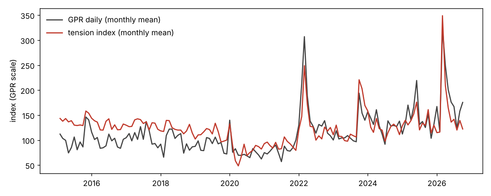
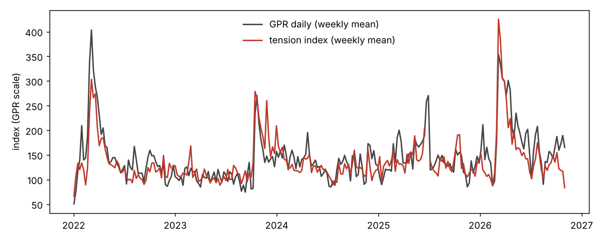

# tension-index

A daily geopolitical tension score computed from GDELT's public news data.
It is built to track the Caldara–Iacoviello **Geopolitical Risk (GPR)** index,
but it is available the morning after each day, whereas the daily GPR is
published weekly.

The score applies the GPR word lists for war, military tension and terror to
the GDELT article stream. It takes the share of matching articles each day
and normalises that share the way GPR does.

**Headline result.** Since September 2019 the index correlates with the daily GPR at

| frequency | correlation |
|---|---|
| daily | 0.77 |
| weekly | 0.86 |
| monthly | 0.90 |

These figures compare the GPR-scale `gpr_nowcast` with the GPR as published.
The index **leads GPR by one day**. Online news reports an event the day it
happens, while the newspapers behind GPR print it the next day. Over the
full 2015–2026 sample the fit is weaker before September 2019, for reasons
explained below.

```
data/tension_daily.csv      one row per day, 2015-02-19 → yesterday (updated daily)
validation/report.md        full validation tables (regenerated by scripts/validate.py)
```

## Contents

* [Using the data](#using-the-data)
* [Method](#method)
* [Validation](#validation)
* [Daily operation](#daily-operation)
* [Reproducing everything](#reproducing-everything)
* [Limitations](#limitations)

## Using the data

`data/tension_daily.csv` has one row per UTC calendar day.  The main columns:

| column | meaning |
|---|---|
| `tension_index` | The score.  GPR-style share index on GPR's scale, with the day-of-week pattern removed. |
| `gpr_nowcast` | Estimate of the daily GPR print for the same date: the mean of `tension_index` on that day and the day before, with GPR's own weekday pattern put back.  Use this to compare with or stand in for `GPRD`. |
| `tension_index_threats`, `tension_index_acts` | Sub-indexes from GPR categories 1–5 (threats) and 6–8 (acts), comparable to `GPRD_THREAT` and `GPRD_ACT`.  From 2019-09; noisier than the main index. |
| `tension_sources` | Which component series went into `tension_index` that day. |
| `idx_fulltext`, `idx_headline`, `idx_headline_and`, `idx_headline_topic`, `idx_theme` | The individual component indexes (see Method). |
| `ft_*`, `hl_*`, `th_*` | Raw daily shares behind each component, plus article counts and full-text coverage. |
| `computed_at` | When the row was last (re)computed. |

Empty rows are days without GDELT data. The longest gap is 2025-06-15 to
2025-07-01, when GDELT published no files at all.

## Method

### What GPR measures

The Caldara–Iacoviello daily GPR counts the articles in ten English-language
newspapers that match a dictionary of eight search categories. The categories
are war threats, peace threats, military buildups, nuclear threats, terror
threats, beginning of war, escalation of war and terror acts. GPR divides that
count by the day's total articles and scales the share so that 1985–2019
averages 100.

Each category pairs a *topic* word set with a *threat* or *act* word set.
Most categories use a proximity search, `N/2`, meaning the two words appear
within two words of each other. A list of excluded words removes film
reviews, obituaries, sport and similar articles. The word lists are in
Table 1 of Caldara & Iacoviello (2022), and are transcribed verbatim in
[`tension_index/wordlists.py`](tension_index/wordlists.py).

### Component series

GDELT publishes in two ways that matter here:

* **Raw 15-minute files.** These are the Events and GKG files on
  `data.gdeltproject.org`. They are complete within about an hour.
* **The DOC 2.0 full-text search API.** It covers the same article stream.

The GKG files carry no article text, but from September 2019 every record
carries its page title. The project builds these component shares:

| component | what is counted | source | history |
|---|---|---|---|
| `headline_topic` | Headlines containing any word from GPR's war, military, nuclear or terrorism topic sets, with GPR's exclusion words applied, as a share of all headlines | raw GKG `<PAGE_TITLE>` | 2019-09 → |
| `headline` | Headlines matching the full GPR rules exactly as published (truncation, `N/2` proximity, `AND`, exclusions), as a share of all headlines | raw GKG `<PAGE_TITLE>` | 2019-09 → |
| `headline_and` | As `headline`, but topic and threat/act words may be anywhere in the headline | raw GKG `<PAGE_TITLE>` | 2019-09 → |
| `fulltext` | English articles whose full text matches each GPR category (topic set AND threat/act set), as a share of all English articles | GDELT DOC 2.0 API | 2017-01 → (see status below) |
| `theme` | GKG records tagged `ARMEDCONFLICT`, `TERROR`, `WMD`, or `MILITARY` together with `BLOCKADE`/`SANCTIONS`/`ACT_FORCEPOSTURE`/`SEIGE` | raw GKG themes | 2015-02 → |

**`tension_index` is the mean of the available *primary* components.** These
are `fulltext` and `headline_topic`. On days with neither, which in practice
means before September 2019, it falls back to `theme`. The configuration is
stored in `data/normalisation.json`.

The strict `headline` rule is the most faithful transcription of GPR. It
matches only about 0.15% of headlines, because a headline seldom holds both
a topic word and a threat word, so its daily noise is high. The topic-word
rule matches about 2% of headlines and tracks GPR best of all components.
GPR's paper observes the same thing: its core topic words alone give "a
similar contour to the final index". The threat and act sub-indexes need
the category rules, so they come from `headline` and `fulltext`.

### Choices and deviations from GPR

* **Language.** Only English-language sources are used. That means
  `sourcelang:english` on the API, and GKG's main files rather than its
  `translation` files. This stays close to GPR's English-language newspapers.
* **Sampling.** The raw-file series read the 24 files published on the hour
  each day from 2019-08-20, about 30,000 headlines a day. Before that they
  read 8 files a day, every three hours, about 10,000 records a day. The
  daily job uses the same 24 hourly files.
* **Wildcards.** The DOC API ignores `*`, so every truncated GPR stem is
  expanded into explicit inflections
  ([`queries.INFLECTIONS`](tension_index/queries.py)). The headline matcher
  applies truncation as a true prefix match.
* **Full-text query limits.** The DOC API rejects queries much beyond about
  300 characters. A 318-character query of "war threat" plus GPR's 34
  exclusion words is already refused. The full-text series therefore runs
  *without* exclusion words. It also uses `AND` rather than `N/2`, because a
  proximity version needs one `nearN:` clause per word pair, which means
  hundreds per category.

  Each category is split into the fewest pieces that fit. The pieces
  partition the topic × threat grid, and their counts are summed. The exact
  queries are recorded in `data/fulltext_plan.json`, and the daily job
  reuses them.
* **Overall full-text share.** This is the sum of the eight category shares,
  so an article in two categories counts twice. A union of all eight cannot
  be expressed in one permitted query. The headline series count each
  headline once, as GPR does.
* **Full-text coverage.** GDELT's full-text index sometimes falls behind or
  has holes. Some days have under 5% of normal volume, for example in
  October–November 2020, 2022-11-11, 2025-12-06 and 2026-10-06/08/10.
  A full-text day is used only when both conditions hold:
  * it has at least 5,000 English articles;
  * it has at least 25% of the median volume of the same weekday over the
    previous eight weeks (`ft_coverage`).

### Day-of-week adjustment

Online conflict coverage *rises* at weekends, when routine business news
thins out. GPR's newspaper shares *fall* at weekends.

| | Mon | Tue | Wed | Thu | Fri | Sat | Sun |
|---|---|---|---|---|---|---|---|
| GPR (relative to mean) | 1.08 | 1.17 | 1.13 | 1.12 | 1.08 | 0.79 | 0.64 |
| headline share (relative to mean) | 0.99 | 0.93 | 0.92 | 0.93 | 0.93 | 1.10 | 1.21 |

Left in, these opposite weekly cycles depress same-day correlations. They
also create a spurious three-day "lead", because the cycles line up best
three days apart. Each component share is therefore divided by its own
weekday factors, estimated over the base period.

* **`tension_index`** has no weekly cycle.
* **`gpr_nowcast`** multiplies the index back by GPR's weekday factors, to
  mimic the published GPR.
* **Validation** compares `tension_index` with GPR after removing GPR's own
  weekday factors, written `GPRD_SA`.

### Normalisation

Like GPR, each component share is divided by its average over a base period.
It is then multiplied by the daily GPR's average over the same period, so
that values are directly on GPR's scale:

    idx_c(t) = share_c(t) / f_c(weekday(t)) / mean(share_c, 2020–2024) × mean(GPRD, 2020–2024)

GPR's own base period, 1985–2019, predates GDELT. The scale is therefore
anchored on 2020–2024, a window in which every component exists. The base
means and weekday factors are stored in `data/normalisation.json`. The daily
job never refits them, so the history does not move when days are added.

## Validation

Source: the official daily GPR (`data_gpr_daily_recent.xls`, downloaded
2026-10-29, vintage ending 2026-10-26), saved as
[`validation/gpr_daily_vintage.csv`](validation/gpr_daily_vintage.csv).
The sample runs from 2015-02-19, the start of GKG 2.0, to 2026-10-26.
Every number below is regenerated by `scripts/validate.py` into
[`validation/report.md`](validation/report.md).

### Correlation at daily, weekly and monthly frequency

Pearson correlation of index levels. Weekly and monthly values are means of
daily values.

| series vs GPR | sample | daily | weekly | monthly |
|---|---|---|---|---|
| `gpr_nowcast` vs `GPRD` (as published) | 2019-09 → 2026-10 | **0.765** | **0.859** | **0.904** |
| `gpr_nowcast` vs `GPRD` (as published) | 2015-02 → 2019-08 | 0.539 | 0.566 | 0.591 |
| `gpr_nowcast` vs `GPRD` (as published) | 2015-02 → 2026-10 | 0.691 | 0.772 | 0.812 |
| `tension_index` vs `GPRD_SA` | 2019-09 → 2026-10 | 0.673 | 0.849 | 0.901 |
| `tension_index` vs `GPRD_SA` | 2015-02 → 2019-08 | 0.343 | 0.575 | 0.622 |
| `tension_index` vs `GPRD_SA` | 2015-02 → 2026-10 | 0.587 | 0.770 | 0.815 |
| `tension_index_threats` vs `GPRD_THREAT_SA` | 2019-09 → 2026-10 | 0.398 | 0.695 | 0.776 |
| `tension_index_acts` vs `GPRD_ACT_SA` | 2019-09 → 2026-10 | 0.260 | 0.383 | 0.562 |

Components, each against `GPRD_SA`:

| component | sample | daily | weekly | monthly |
|---|---|---|---|---|
| `headline_topic` | 2019-09 → 2026-10 | 0.675 | 0.855 | 0.903 |
| `headline_and` | 2019-09 → 2026-10 | 0.497 | 0.744 | 0.858 |
| `headline` (strict GPR rules) | 2019-09 → 2026-10 | 0.406 | 0.648 | 0.809 |
| `theme` | 2015-02 → 2026-10 | 0.443 | 0.580 | 0.584 |

The fit depends on how much is happening. In eventful years daily
correlation is high: 0.71 in 2022, 0.61 in 2023 and 0.74 in 2026 to date.
In calm years it is low, for example 0.27 in 2024. The daily GPR itself is
noisy at those times. In 2019–2021 its own day-to-day autocorrelation is
only 0.37, which caps what any tracker can reach.




### Lead / lag

Cross-correlations of `tension_index(t)` with `GPRD_SA(t+k)`, both weekday-adjusted:

| k (days) | −3 | −2 | −1 | 0 | **+1** | +2 | +3 |
|---|---|---|---|---|---|---|---|
| levels | 0.532 | 0.542 | 0.564 | 0.587 | **0.603** | 0.564 | 0.543 |
| log deviation from 30-day mean | 0.187 | 0.205 | 0.218 | 0.267 | **0.305** | 0.250 | 0.232 |
| daily log change | 0.006 | 0.005 | −0.033 | 0.010 | **0.083** | −0.035 | 0.018 |

**The index leads GPR by one day.** The peak sits at k = +1 under every
transformation, for every component, and in almost every calendar year.

A predictive test on daily log changes, with five lags, points the same way:

| direction | increase in R² |
|---|---|
| index lags added to a regression of GPR on its own lags | 0.017 |
| GPR lags added to a regression of the index on its own lags | 0.0015 |

The lead is mechanical. A GDELT article is dated when it appears online,
usually the day of the event. A newspaper article in GPR is dated by its
print edition, usually the next day.

GPR's day-t print mixes previous-day and same-day news. That is why
`gpr_nowcast` averages days t and t−1. This raises the daily correlation
with published GPR from 0.734 to 0.765 over 2019-09 → 2026-10.

**In timing terms:**

* `tension_index` for day t is final by about 05:00 UTC on day t+1. That is
  already one day ahead of the news content of GPR's day-t+1 print.
* The official daily GPR is posted once a week, on Mondays, and is revised
  in later vintages.

### Full-text component: shelved

The full-text component is shelved. The tension index was closed as a
trading signal: a test against gold and silver returns found no predictive
value out of sample. That test is in `reports/gold_test.md` on the branch
`claude/tension-index-gpr-zp1hcb`. Completing the full-text history is
therefore no longer worth the effort.

* **What exists.** The code is in place, and the English article totals for
  2017-01-01 to 2026-10-27 are in `data/history_fulltext.csv`. No category
  counts were pulled. GDELT's DOC API refused almost every category query on
  2026-10-28/29, from this project's container and from GitHub-hosted
  runners alike.
* **What runs.** The last backfill attempt was run 5, started 2026-10-29.
  No further runs or retries are scheduled. The daily workflow keeps
  publishing the index from the raw-file components. It skips the
  full-text step because no query plan (`data/fulltext_plan.json`) exists
  on the default branch.

The published index is therefore built as follows:

* since 2019-09 it is `headline_topic`;
* before 2019-09 it is `theme`;
* the validation figures above are for those components.

## Daily operation

[`.github/workflows/daily.yml`](.github/workflows/daily.yml) runs every day
at 05:23 UTC and can also be run by hand for any date. It runs
`scripts/daily.py`, which:

1. Downloads yesterday's 24 hourly GKG and Events files, about 2 minutes,
   and computes the headline and theme shares.
2. If the full-text plan exists, re-pulls the full-text counts for the
   trailing 10 days. That lets late-indexed days fill in. The pull has a
   30-minute budget for rate limiting, and the starting query piece rotates
   by date so every piece is refreshed over successive runs. A day gets a
   full-text share only when all of its pieces are present. If the API
   fails, the index is still published from the raw-file components.
3. Applies the stored normalisation and upserts the rows into
   `data/tension_daily.csv`, along with any refreshed full-text counts in
   `data/history_fulltext.csv`. It then commits and pushes.

The scheduled workflow runs from the repository's default branch. Merge
this branch for it to start.

## Reproducing everything

```bash
pip install -r requirements.txt

# 1. Raw-file history (≈1.5 h; resumable).  Writes per-slot counts.
python scripts/backfill_raw.py --start 2015-02-19 --end 2019-08-19 --out raw_3h.csv --workers 16
python scripts/backfill_raw.py --start 2019-08-20 --end 2026-10-28 --out raw_hourly.csv \
    --workers 24 --hours $(seq -s, 0 23)
gzip -c raw_3h.csv > data/raw/raw_slots_3h.csv.gz; gzip -c raw_hourly.csv > data/raw/raw_slots_hourly.csv.gz

# 2. Full-text history from the DOC API (rate-limited; resumable).
python scripts/build_history.py --patient

# 3. Combine, normalise, validate.
python scripts/rebuild_daily.py                 # writes data/tension_daily.csv, data/normalisation.json
python scripts/validate.py                      # downloads the latest GPR; writes validation/

# 4. One day.
python scripts/daily.py --date 2026-10-28

python -m pytest tests
```

Note: the archived 3-hourly file in `data/raw/` covers 2015-02-19 to
2026-10-27. The hourly file from 2019-08-20 overrides it where the two
overlap.

## Limitations

* **Not the GPR corpus.** GDELT covers tens of thousands of online outlets,
  far more international and local than GPR's ten US, UK and Canadian
  newspapers. Topic mix, outlet mix and GDELT's own source list change over
  time. The levels are therefore only comparable to GPR through the
  normalisation, and long-run trends can differ. The 2015–2018 level sits
  above GPR, for example.
* **Weaker before September 2019.** Page titles enter GKG only around
  September 2019. Before that, the index rests on GDELT's theme tagger, a
  proxy rather than the GPR word lists. It reaches only 0.34 daily and 0.62
  monthly correlation. The shelved full-text component would have covered
  2017–2019 with the word lists.
* **Headlines are not articles.** The main component counts headlines, not
  article bodies. It uses GPR's topic words but not the threat and act
  pairing, so it measures how much of the news is about war, the military,
  nuclear weapons and terrorism, rather than threats specifically. The
  threat and act sub-indexes use the full rules, and are noisier.
* **Full-text deviations.** The full-text component cannot use GPR's
  exclusion words or `N/2` proximity, because of the API's query-length
  limit. It also depends on an API that is rate-limited and sometimes
  stalls. See the status above.
* **GDELT outages.** No data at all exists for 2025-06-15 to 2025-07-01,
  which includes most of the June 2025 Israel–Iran war, or for 2015-10-22.
  There are partial gaps in October–November 2020, August 2021,
  November 2022 and March 2023.
* **Day boundaries.** GDELT days are UTC. GPR days are newspaper print
  dates.
* **GPR revisions.** The daily GPR is preliminary and gets revised as
  newspapers are added to its database. Validation uses one vintage.
* **Daily noise.** Even at its best, a daily correlation of about 0.75
  leaves substantial day-to-day differences. For decisions, the weekly
  average, at 0.86, is more reliable.

## Sources

* Caldara, Dario and Matteo Iacoviello (2022), "Measuring Geopolitical Risk",
  *American Economic Review* 112(4), 1194–1225.  Data from
  https://www.matteoiacoviello.com/gpr.htm (downloaded 2026-10-29).
* GDELT Project: GDELT 2.0 Event and Global Knowledge Graph files
  (http://data.gdeltproject.org/gdeltv2/) and the DOC 2.0 API
  (https://api.gdeltproject.org/api/v2/doc/doc).
