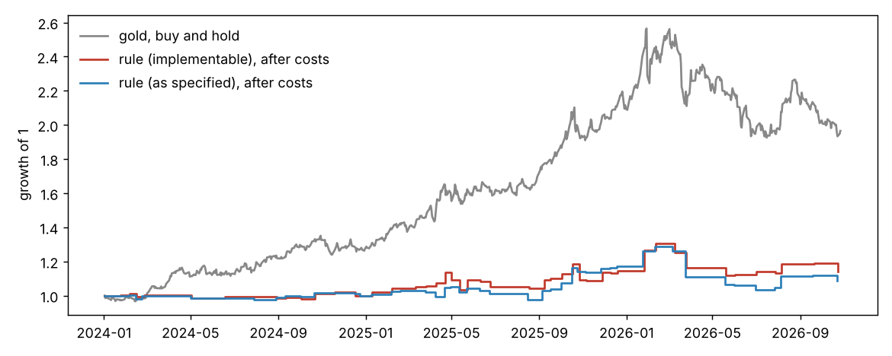

# Does the tension index predict gold and silver?

Generated 2026-10-29 03:19 UTC by `scripts/gold_test.py`. Training sample 2019-09-01 to 2023-12-31; test sample 2024-01-01 to 2026-10-27 (evaluated once).

Signal: `z_tension`, the change in the (training-period weekday-adjusted) tension index from the previous trading day to today, in log points, standardised with training-period mean and SD (1 unit = 1 SD, 0.227 log points).  Controls: today's change in the 10y TIPS real yield (bp), the dollar index log return (%) and the VIX change (points).  Returns are log returns in %; coefficients on `z_tension` are shown in basis points of return per 1 SD.

Two timings.  *as_specified*: return from today's close.  The index day ends at 24:00 UTC, after the COMEX close, and is published about 05:23 UTC the next day, so this return overlaps a few hours of the same news and could not have been traded.  *implementable*: return from the next day's close, after the index is published.

## Coefficients on z_tension (training sample, Newey-West SE)

| metal | spec | h | model | coef_bp | se_bp | t | p | n |
|---|---|---|---|---|---|---|---|---|
| gold | as_specified | 1 | tension | -5.52 | 3.23 | -1.71 | 0.09 | 1069 |
| gold | as_specified | 1 | tension+controls | -5.53 | 3.21 | -1.72 | 0.08 | 1069 |
| gold | as_specified | 5 | tension | 6.26 | 5.44 | 1.15 | 0.25 | 1065 |
| gold | as_specified | 5 | tension+controls | 8.32 | 5.69 | 1.46 | 0.14 | 1065 |
| gold | as_specified | 20 | tension | 8.03 | 6.41 | 1.25 | 0.21 | 1050 |
| gold | as_specified | 20 | tension+controls | 8.45 | 6.41 | 1.32 | 0.19 | 1050 |
| gold | implementable | 1 | tension | 5.03 | 3.22 | 1.56 | 0.12 | 1068 |
| gold | implementable | 1 | tension+controls | 6.14 | 3.13 | 1.96 | 0.05 | 1068 |
| gold | implementable | 5 | tension | 8.42 | 5.00 | 1.68 | 0.09 | 1064 |
| gold | implementable | 5 | tension+controls | 10.23 | 5.07 | 2.02 | 0.04 | 1064 |
| gold | implementable | 20 | tension | 10.93 | 7.00 | 1.56 | 0.12 | 1049 |
| gold | implementable | 20 | tension+controls | 10.95 | 6.85 | 1.60 | 0.11 | 1049 |
| silver | as_specified | 1 | tension | -13.96 | 7.03 | -1.98 | 0.05 | 1069 |
| silver | as_specified | 1 | tension+controls | -13.22 | 6.96 | -1.90 | 0.06 | 1069 |
| silver | as_specified | 5 | tension | 10.41 | 11.18 | 0.93 | 0.35 | 1065 |
| silver | as_specified | 5 | tension+controls | 14.90 | 12.25 | 1.22 | 0.22 | 1065 |
| silver | as_specified | 20 | tension | 3.61 | 14.26 | 0.25 | 0.80 | 1050 |
| silver | as_specified | 20 | tension+controls | 7.10 | 16.89 | 0.42 | 0.67 | 1050 |
| silver | implementable | 1 | tension | 9.59 | 6.00 | 1.60 | 0.11 | 1068 |
| silver | implementable | 1 | tension+controls | 11.33 | 6.12 | 1.85 | 0.06 | 1068 |
| silver | implementable | 5 | tension | 18.94 | 10.22 | 1.85 | 0.06 | 1064 |
| silver | implementable | 5 | tension+controls | 23.01 | 11.15 | 2.06 | 0.04 | 1064 |
| silver | implementable | 20 | tension | 14.21 | 13.08 | 1.09 | 0.28 | 1049 |
| silver | implementable | 20 | tension+controls | 17.38 | 14.91 | 1.17 | 0.24 | 1049 |

Same regression re-fitted on the test sample (descriptive only; not used for forecasting):

| metal | spec | h | coef_bp | se_bp | t | p | n |
|---|---|---|---|---|---|---|---|
| gold | as_specified | 1 | 3.93 | 6.03 | 0.65 | 0.51 | 698 |
| gold | as_specified | 5 | 0.33 | 9.46 | 0.03 | 0.97 | 694 |
| gold | as_specified | 20 | -8.69 | 17.47 | -0.50 | 0.62 | 679 |
| gold | implementable | 1 | -2.09 | 5.88 | -0.36 | 0.72 | 697 |
| gold | implementable | 5 | -4.36 | 8.42 | -0.52 | 0.60 | 693 |
| gold | implementable | 20 | -10.66 | 13.60 | -0.78 | 0.43 | 678 |
| silver | as_specified | 1 | 9.92 | 11.74 | 0.84 | 0.40 | 698 |
| silver | as_specified | 5 | 0.40 | 17.59 | 0.02 | 0.98 | 694 |
| silver | as_specified | 20 | 5.17 | 27.93 | 0.19 | 0.85 | 679 |
| silver | implementable | 1 | -11.51 | 11.91 | -0.97 | 0.33 | 697 |
| silver | implementable | 5 | -7.19 | 16.59 | -0.43 | 0.67 | 693 |
| silver | implementable | 20 | -17.20 | 22.98 | -0.75 | 0.45 | 678 |

Control coefficients (training, tension+controls model) are in `gold_test_coefficients.csv`.

## Out-of-sample (test sample, training coefficients)

RMSE in % return (lower is better).  R²_oos = 1 − SSE(model)/SSE(benchmark); negative means worse than the benchmark.  DM p = Diebold-Mariano test of equal squared error (HAC).

| metal | spec | h | n_test | rmse_zero | rmse_mean | rmse_controls | rmse_tension | rmse_both |
|---|---|---|---|---|---|---|---|---|
| gold | as_specified | 1 | 698 | 1.4044 | 1.4026 | 1.4026 | 1.4049 | 1.4053 |
| gold | as_specified | 5 | 694 | 3.0127 | 2.9905 | 2.9996 | 2.9910 | 3.0011 |
| gold | as_specified | 20 | 679 | 5.8743 | 5.6871 | 5.6892 | 5.6888 | 5.6914 |
| gold | implementable | 1 | 697 | 1.4043 | 1.4023 | 1.4089 | 1.4038 | 1.4114 |
| gold | implementable | 5 | 693 | 3.0148 | 2.9919 | 3.0048 | 2.9941 | 3.0088 |
| gold | implementable | 20 | 678 | 5.8784 | 5.6901 | 5.6902 | 5.6930 | 5.6936 |
| silver | as_specified | 1 | 698 | 3.0318 | 3.0309 | 3.0245 | 3.0377 | 3.0314 |
| silver | as_specified | 5 | 694 | 6.3275 | 6.3151 | 6.3258 | 6.3158 | 6.3278 |
| silver | as_specified | 20 | 679 | 11.5137 | 11.3957 | 11.3999 | 11.3957 | 11.4001 |
| silver | implementable | 1 | 697 | 3.0314 | 3.0304 | 3.0379 | 3.0350 | 3.0443 |
| silver | implementable | 5 | 693 | 6.3314 | 6.3185 | 6.3369 | 6.3230 | 6.3444 |
| silver | implementable | 20 | 678 | 11.5219 | 11.4028 | 11.4084 | 11.4056 | 11.4128 |

Gains in squared error.  `mean` is a model with only an intercept fitted on the training sample (gold's 2019-2023 drift); it isolates what the tension slope adds beyond that drift.

| metal | spec | h | r2oos_tension_vs_zero | dm_p_tension_vs_zero | r2oos_mean_vs_zero | r2oos_tension_vs_mean | dm_p_tension_vs_mean | r2oos_both_vs_controls | dm_p_both_vs_controls |
|---|---|---|---|---|---|---|---|---|---|
| gold | as_specified | 1 | -0.0007 | 0.8363 | 0.0026 | -0.0033 | 0.2729 | -0.0039 | 0.1978 |
| gold | as_specified | 5 | 0.0144 | 0.0468 | 0.0147 | -0.0004 | 0.7409 | -0.0010 | 0.5110 |
| gold | as_specified | 20 | 0.0622 | 0.0214 | 0.0627 | -0.0006 | 0.4070 | -0.0007 | 0.3281 |
| gold | implementable | 1 | 0.0007 | 0.8331 | 0.0028 | -0.0021 | 0.4300 | -0.0036 | 0.2752 |
| gold | implementable | 5 | 0.0137 | 0.0758 | 0.0151 | -0.0015 | 0.2971 | -0.0027 | 0.1109 |
| gold | implementable | 20 | 0.0621 | 0.0240 | 0.0630 | -0.0010 | 0.1789 | -0.0012 | 0.1140 |
| silver | as_specified | 1 | -0.0039 | 0.2004 | 0.0006 | -0.0045 | 0.1507 | -0.0046 | 0.1279 |
| silver | as_specified | 5 | 0.0037 | 0.2295 | 0.0039 | -0.0002 | 0.7666 | -0.0006 | 0.5821 |
| silver | as_specified | 20 | 0.0204 | 0.1318 | 0.0204 | 0.0000 | 0.9332 | -0.0000 | 0.8912 |
| silver | implementable | 1 | -0.0024 | 0.2995 | 0.0006 | -0.0030 | 0.1707 | -0.0043 | 0.1051 |
| silver | implementable | 5 | 0.0026 | 0.4285 | 0.0041 | -0.0014 | 0.3085 | -0.0024 | 0.1634 |
| silver | implementable | 20 | 0.0201 | 0.1442 | 0.0206 | -0.0005 | 0.2454 | -0.0008 | 0.1432 |

Direction hit rates on the test sample.  `share_up` is the hit rate of always predicting a rise. `hit_tension_slope_only` uses only the sign of the slope × signal (ignores the intercept, which mostly encodes gold's uptrend).

| metal | spec | h | hit_tension | hit_tension_slope_only | hit_controls | hit_both | share_up |
|---|---|---|---|---|---|---|---|
| gold | as_specified | 1 | 0.534 | 0.486 | 0.507 | 0.509 | 0.557 |
| gold | as_specified | 5 | 0.608 | 0.493 | 0.588 | 0.561 | 0.610 |
| gold | as_specified | 20 | 0.664 | 0.501 | 0.664 | 0.664 | 0.664 |
| gold | implementable | 1 | 0.547 | 0.509 | 0.506 | 0.512 | 0.558 |
| gold | implementable | 5 | 0.608 | 0.518 | 0.592 | 0.577 | 0.610 |
| gold | implementable | 20 | 0.665 | 0.482 | 0.665 | 0.665 | 0.665 |
| silver | as_specified | 1 | 0.486 | 0.471 | 0.507 | 0.494 | 0.554 |
| silver | as_specified | 5 | 0.543 | 0.494 | 0.530 | 0.520 | 0.563 |
| silver | as_specified | 20 | 0.616 | 0.496 | 0.589 | 0.591 | 0.616 |
| silver | implementable | 1 | 0.488 | 0.471 | 0.519 | 0.496 | 0.555 |
| silver | implementable | 5 | 0.538 | 0.498 | 0.522 | 0.518 | 0.563 |
| silver | implementable | 20 | 0.618 | 0.497 | 0.600 | 0.600 | 0.618 |

## Same-day reaction (descriptive)

Today's metal return (previous close to today's close) on today's tension change.

| metal | period | model | coef_z_tension | t | p | n |
|---|---|---|---|---|---|---|
| gold | train | tension | 0.064 | 2.106 | 0.035 | 1070 |
| gold | train | tension+controls | 0.040 | 1.537 | 0.124 | 1070 |
| gold | test | tension | 0.095 | 1.578 | 0.115 | 699 |
| gold | test | tension+controls | 0.095 | 1.673 | 0.094 | 699 |
| silver | train | tension | 0.155 | 2.319 | 0.020 | 1070 |
| silver | train | tension+controls | 0.122 | 2.054 | 0.040 | 1070 |
| silver | test | tension | 0.211 | 1.472 | 0.141 | 699 |
| silver | test | tension+controls | 0.204 | 1.480 | 0.139 | 699 |

## Gold against the official GPR (descriptive)

Same weekday adjustment and day-change construction applied to the published daily GPR (validation vintage).  Coefficients in bp of gold return per 1 SD change.

| period | gold return | signal | coef_bp_per_sd | t | n |
|---|---|---|---|---|---|
| train | same day | z_gpr | 1.37 | 0.42 | 1091 |
| train | same day | z_tension | 6.41 | 2.11 | 1070 |
| train | next day (from today's close) | z_gpr | 6.11 | 1.94 | 1091 |
| train | next day (from today's close) | z_tension | -5.50 | -1.70 | 1070 |
| test | same day | z_gpr | 4.49 | 0.71 | 708 |
| test | same day | z_tension | 9.53 | 1.58 | 699 |
| test | next day (from today's close) | z_gpr | -4.25 | -0.61 | 708 |
| test | next day (from today's close) | z_tension | 3.93 | 0.65 | 698 |

## Trading rule: long gold for 5 trading days after a top-decile daily index rise

Top decile = training-period 90th percentile of the daily tension change (0.280 log points, fixed for the test).  Entry at the close (today for as_specified, next day for implementable); exit 5 trading days later; 0.1% round-trip cost per trade; signals during an open trade are ignored.  `uncond_5d_mean_net_pct` is the average 5-day gold return (after the same cost) from every day in the period: the bar the rule has to clear.  `random_entry_p` is the share of 5,000 random sets of the same number of entry days whose mean is at least the rule's.

| spec | period | signals | trades | mean_net_pct | median_net_pct | hit_rate | total_net_pct | mean_net_ex5best_pct | total_net_ex5best_pct | uncond_5d_mean_net_pct | random_entry_p | buy_hold_pct | days_invested_share |
|---|---|---|---|---|---|---|---|---|---|---|---|---|---|
| as_specified | train | 107 | 77 | 0.142 | 0.060 | 0.506 | 9.589 | -0.145 | -11.112 | 0.062 | 0.378 | 34.019 | 0.353 |
| as_specified | test | 63 | 48 | 0.227 | 0.104 | 0.500 | 8.763 | -0.512 | -20.918 | 0.431 | 0.701 | 96.518 | 0.338 |
| implementable | train | 107 | 77 | 0.281 | 0.378 | 0.558 | 21.736 | -0.066 | -5.874 | 0.062 | 0.203 | 34.019 | 0.353 |
| implementable | test | 63 | 48 | 0.331 | 0.419 | 0.562 | 14.119 | -0.372 | -16.137 | 0.431 | 0.610 | 96.518 | 0.338 |

By year of entry:

| spec | year | trades | mean_net_pct | hit_rate | total_net_pct | uncond_5d_mean_net_pct | gold_year_pct |
|---|---|---|---|---|---|---|---|
| as_specified | 2019 | 4 | -0.118 | 0.750 | -0.570 | 0.440 | 14.879 |
| as_specified | 2020 | 19 | 0.787 | 0.632 | 15.368 | 0.357 | 24.310 |
| as_specified | 2021 | 20 | -0.731 | 0.350 | -13.952 | -0.194 | -6.062 |
| as_specified | 2022 | 19 | 0.292 | 0.526 | 5.309 | -0.018 | 1.450 |
| as_specified | 2023 | 15 | 0.368 | 0.467 | 5.428 | 0.112 | 12.226 |
| as_specified | 2024 | 15 | 0.007 | 0.400 | -0.021 | 0.441 | 27.375 |
| as_specified | 2025 | 22 | 0.770 | 0.591 | 17.404 | 0.955 | 62.649 |
| as_specified | 2026 | 11 | -0.558 | 0.455 | -7.341 | -0.240 | -5.890 |
| implementable | 2019 | 4 | -0.320 | 0.250 | -1.329 | 0.440 | 14.879 |
| implementable | 2020 | 19 | 1.316 | 0.737 | 27.546 | 0.357 | 24.310 |
| implementable | 2021 | 20 | -0.505 | 0.400 | -10.030 | -0.194 | -6.062 |
| implementable | 2022 | 19 | 0.038 | 0.579 | 0.259 | -0.018 | 1.450 |
| implementable | 2023 | 14 | 0.669 | 0.643 | 9.480 | 0.112 | 12.226 |
| implementable | 2024 | 16 | -0.141 | 0.438 | -2.363 | 0.441 | 27.375 |
| implementable | 2025 | 22 | 0.701 | 0.636 | 15.105 | 0.955 | 62.649 |
| implementable | 2026 | 11 | 0.060 | 0.545 | -0.537 | -0.240 | -5.890 |

